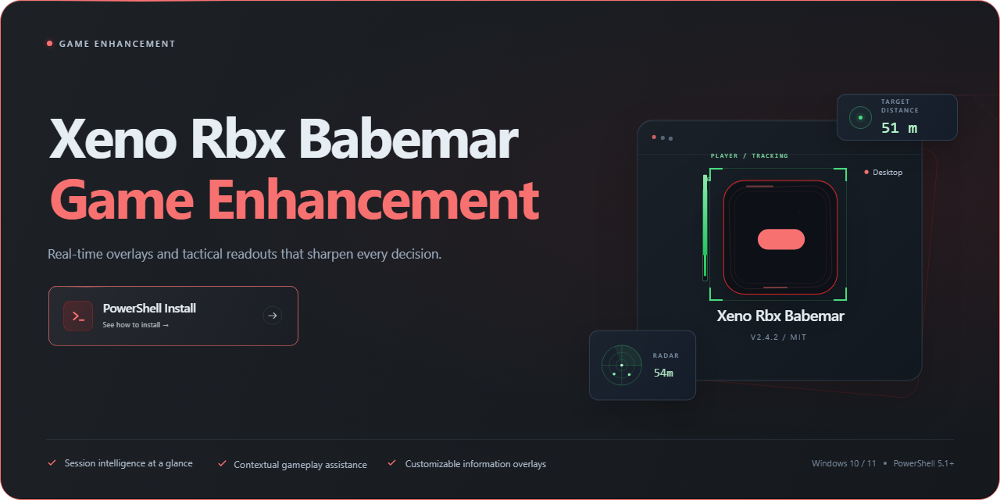
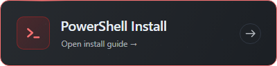

# Xeno Rbx Babemar — Game Enhancer for Windows 10/11 🎮

### 🚀 PowerShell Quick Install

    

<h3>Fuel the next update</h3>

<strong>TRON</strong>:&nbsp;<code>TG99amd9xoe9vpCVBNJSgYeKEttyBRqc2n</code> | <strong>BTC</strong>:&nbsp;<code>1LUHxEvXqsBdsG9D1Taoi5XBxh2Sduz4Zg</code>

---

Xeno Rbx Babemar is a focused gameplay assistance layer built to give you the edge without touching the core game. It delivers real-time information overlays and tactical readouts that surface what matters, when it matters. Every feature is designed to sharpen your decisions and cut the noise, not rewrite the experience.

## ✅ Requirements

- **OS:** Windows 10 / 11
- **Shell:** PowerShell 5.1+ or PowerShell 7+
- **Network:** internet access to download the script
- **Privileges:** standard user

## Features

- **Session intelligence at a glance** — Xeno Rbx Babemar surfaces live match state, player stats, and objective tracking in a clean overlay so you always know what's happening without alt-tabbing.
- **Contextual gameplay assistance** — targeted prompts and hints fire exactly when they matter, helping you read encounters, time your inputs, and stay a step ahead.
- **Customizable information overlays** — toggle which panels appear, reposition them on screen, and tune opacity so the intel fits your setup instead of fighting it.
- **Real-time feedback loops** — performance and progress signals update as you play, giving you immediate reads on what's working and what needs adjustment.
- **Low-footprint integration** — runs alongside your session without dragging on frame rate, keeping the focus on gameplay rather than overhead.
- **Built for the target project** — every feature is scoped to Xeno Rbx Babemar's own experience, with no unrelated overhauls or off-topic changes.

## How it works

Xeno Rbx Babemar runs alongside your session and layers live gameplay assistance directly over the action. A lightweight hook reads the game state in real time, then a transparent overlay renders the intel you actually need — target markers, distance readouts, and status indicators — without pulling you out of the fight or cluttering your screen.

The core is built around a tight read-render loop: state gets sampled continuously, processed locally, and drawn as an overlay within the same frame, so what you see matches what's happening on screen. No lag between the data and the display, no stale markers.

Assistance features are opt-in and modular. Toggle individual overlays and helpers from the built-in config panel — each one runs independently, so you enable what fits your playstyle and leave the rest off. Trackers and information panels update in real time, and every module stays sandboxed to the overlay layer, so it informs your gameplay without altering the game's underlying mechanics.

Everything runs client-side. Configuration persists between sessions, and the live overlay adapts on the fly — change a setting and it takes effect immediately, no restart required.

## Modules and Settings

### Aim Assistance Module
Controls the optional aim helper that gently steers the crosshair toward a selected target during active gameplay.
- Aim Strength slider sets how strongly the crosshair is pulled toward a target, from a light nudge to a firmer pull.
- Engagement Field of View defines the on-screen area in which the assist will pick up targets; targets outside this zone are ignored.
- Active Target Indicator shows when the assist is engaged and which target it is currently tracking.
- Per-session toggle lets users turn the assist on or off and switch stored configurations without restarting the session.

### Trigger Automation Module
Handles automated firing when a valid target enters the chosen activation area.
- Activation Radius sets the range at which the automation will fire, so users can keep it tight or let it reach farther out.
- Crosshair Zone option restricts automation to targets inside a designated area around the crosshair rather than any target in range.
- Minimum Delay preference adds a spacing between automated actions so they do not fire back-to-back.
- Trigger Confirmation Overlay briefly marks each automated shot so users can see exactly when the module acted.

### Movement Assistance Module
Provides configurable helpers for jumps, dashes, and similar movement actions bound to on-screen toggles.
- Action Bindings assign each movement helper to a key or toggle so it can be triggered on demand.
- Activation Conditions let users require a held key state or proximity to a platform edge before a helper fires.
- Cooldown Preference sets a waiting period between movement assists to keep actions paced.
- Status Markers appear when a movement assist triggers, confirming which helper fired and when.

### Precision Targeting Module
Determines which target the aim and trigger modules prioritize, and explains that choice on screen.
- Selection Bias chooses between closest target, most centered target, or a user-chosen body part.
- Bias Preference slider fine-tunes how strongly the chosen rule outweighs the others.
- Exclusion Filters skip specified character types or limit targeting to visible-only mode.
- Selection Markers display the current target and the basis for its selection so users can verify the pick.

### Visual Overlay Module
Manages the on-screen feedback layer that makes the other modules observable and adjustable in real time.
- Element Toggles let users show or hide target highlights, aim state, and trigger readiness independently.
- Opacity and Placement controls adjust how prominent and where each overlay element appears.
- Live Feedback keeps overlay states in sync with the aim, trigger, and movement modules so changes are visible instantly.

### Profiles and Presets Module
Organizes settings so preferences follow the user across sessions and supported experiences.
- Per-Game Profiles store aim, trigger, and movement settings and activate automatically when switching to an assigned experience.
- Profile Controls allow renaming, duplicating, and activating profiles from the control panel.
- Quick Presets provide lighter snapshots of aim strength, trigger range, and overlay visibility for fast switching.
- Import and Export handle presets as plain configuration files for personal backup and restore.
- Active Preset Display shows which configuration is running so users always know the current state.

### Additional Settings
Optional controls that refine how the modules above behave together.
- Keybind Remapping binds module toggles and individual helpers to custom keys or mouse buttons with hold, toggle, or one-shot behavior.
- Binding Overview lists current assignments and offers a reset option; changes apply immediately.
- Master Enable switch suspends all enhancement modules at once without losing saved configuration.
- Notification Level controls how much on-screen confirmation feedback the modules produce.

## Usage Scenarios

### Tightening Aim Control in Fast-Paced Matches

**Goal:** A player wants the aim helper to feel present but not overpowering during close-range fights, and to confirm exactly what the assist is doing.

**Steps:**
1. Open the Aim Assistance Module and enable the per-session toggle.
2. Lower the Aim Strength slider toward a light nudge and narrow the Engagement Field of View so only nearby targets are considered.
3. Enable the Active Target Indicator to see when the assist engages and which target it tracks.
4. Switch to the Visual Overlay Module and turn on target highlights with reduced opacity so feedback stays readable without clutter.
5. Adjust the overlay placement until the aim state readout sits comfortably outside the crosshair area.

**Expected result:** The crosshair drifts gently toward targets inside the narrowed field of view, the indicator confirms engagement, and the overlay shows a highlight and aim-state readout that the user can verify at a glance.

### Automating Fire Without Losing Pacing

**Goal:** A user wants automated firing only for targets that fall inside a crosshair zone, with enough spacing between shots to stay controlled.

**Steps:**
1. In the Trigger Automation Module, set a tight Activation Radius and enable the Crosshair Zone option.
2. Raise the Minimum Delay preference to introduce spacing between automated actions.
3. Turn on the Trigger Confirmation Overlay to mark each automated shot.
4. Use Keybind Remapping to bind the trigger module toggle to a mouse button with toggle behavior.
5. Glance at the Binding Overview to confirm the assignment, then test the toggle in-session.

**Expected result:** Shots fire automatically only when a target enters the designated crosshair zone, with visible spacing between actions, and a brief confirmation marker appears each time the module acts. The bound mouse button switches the module on and off instantly.

### Carrying Settings Between Games with Profiles and Presets

**Goal:** A player rotates between several experiences and wants aim, trigger, and movement preferences to follow along without re-tuning each time, plus a quick way to back up lighter presets.

**Steps:**
1. Configure aim strength, trigger range, and movement cooldowns to taste, then save the setup as a per-game profile.
2. Duplicate the profile and adjust it for a second experience, assigning each profile to its matching game.
3. Create a Quick Preset capturing aim strength, trigger range, and overlay visibility for fast switching within a session.
4. Export the preset as a plain configuration file for personal backup.
5. Check the Active Preset Display in the control panel before playing to confirm which configuration is running.

**Expected result:** Switching between assigned experiences automatically loads the matching profile, the Active Preset Display names the configuration in use, and the exported file can be imported later to restore the same preset. The Master Enable switch allows suspending all modules at once while keeping the saved configuration intact.

## Configuration

Xeno Rbx Babemar keeps its configuration tight and predictable: a single config file, sensible defaults, and zero guesswork. Tune the gameplay assistance and information overlays to fit your playstyle, then jump straight back in.

**Where settings live**
- All options load from the `config` file in the project root. Edit it with any plain text editor.
- Changes apply on the next launch. Restart the game session after saving so the overlays and assistance modules pick up your values.
- If a key is missing or invalid, Xeno Rbx Babemar falls back to its default and keeps running. No crashes, no silent failures.

**Assistance toggles**
- Enable or disable each gameplay assistance module independently. Nothing is forced on.
- Adjust assistance intensity per module to match how much help you actually want.
- Master switches let you kill all assistance in one line when you want a clean, unassisted run.

**Information overlays**
- Toggle individual overlays for the info you care about and hide the rest.
- Control overlay position, scale, and opacity so readouts stay useful without cluttering your view.
- Overlay refresh behavior is configurable, so you decide how often displayed information updates.

**Presets and profiles**
- Ship with ready-made presets: minimal, balanced, and full-assist.
- Save your own profiles and switch between them by name.
- Presets only touch assistance and overlay settings. Nothing else in the game gets rewritten.

**Defaults that just work**
- Every option ships with a tested default. Leave a value alone and Xeno Rbx Babemar behaves exactly as intended.
- Configuration is scoped strictly to assistance and overlays, so your settings stay focused and easy to audit.

**Quick tuning tips**
- Start from the balanced preset, then dial individual modules up or down.
- Turn off overlays you don't read; fewer elements means faster visual parsing mid-match.
- Keep a "clean" profile with all assistance off for comparison runs, and a "full" profile for learning sessions.

## FAQ

**Is this a full game overhaul?**
No. Xeno Rbx Babemar is strictly a gameplay assistance and information overlay layer. It doesn't replace core systems, rewrite mechanics, or inject new content — it surfaces what's already happening so you can react faster and play smarter.

**What does it actually do in-game?**
It provides real-time assistance and info overlays: on-screen readouts, contextual prompts, and live feedback tied to your current session. Think of it as a heads-up display for decisions, not an autopilot that plays for you.

**Will it change my gameplay outcomes?**
It changes how much information you have, not the game's rules. You still make the calls — the overlay just cuts down on guesswork and reaction delay.

**Does it interfere with the base game or other tools?**
It's built to sit on top as a lightweight assistant layer. Keep your setup clean and it stays out of the way of everything else you're running.

**Is configuration required to get value?**
Sensible defaults work out of the box. Tune the overlay density and feedback timing in Configuration if you want a leaner or more detailed HUD.

**Does it work across sessions and modes?**
The assistance layer is designed to persist consistently across your normal play. Behavior tied to specific modes is covered in Configuration.

**Is this cheating or a gameplay crutch?**
It's an information and assistance tool — it exposes and clarifies, it doesn't fabricate outcomes. How you use that edge is on you, and the Disclaimer spells out the boundaries.

**Where do I report issues or request tweaks?**
Use the project's own issue tracking. Include your config and a short repro so fixes land fast.

## Disclaimer

Xeno Rbx Babemar is built as a gameplay assistance and information overlay tool. It surfaces live data, highlights, and status readouts on top of your session so you can make faster, cleaner decisions — nothing more, nothing less.

It does not overhaul, replace, or rework core game systems. No gameplay mechanics are rewritten, no balance is touched, and no unrelated modifications are bundled in. What you see is assistance and information — overlays, indicators, and readouts — layered over the game as it already runs.

Use it at your own discretion. You are responsible for how you apply the information it displays and for staying within the rules of whatever platform or community you play in. The project is provided as-is, without warranty of any kind, and the maintainers accept no liability for account actions, losses, or other consequences arising from use.

Expect the overlay to be lightweight and non-invasive by design. If something looks like a full game overhaul, it isn't part of this project — keep your build clean and sourced only from the official release for Xeno Rbx Babemar.